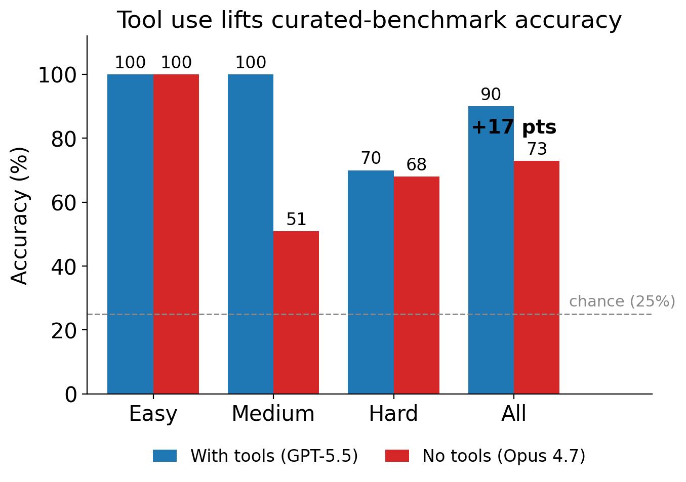
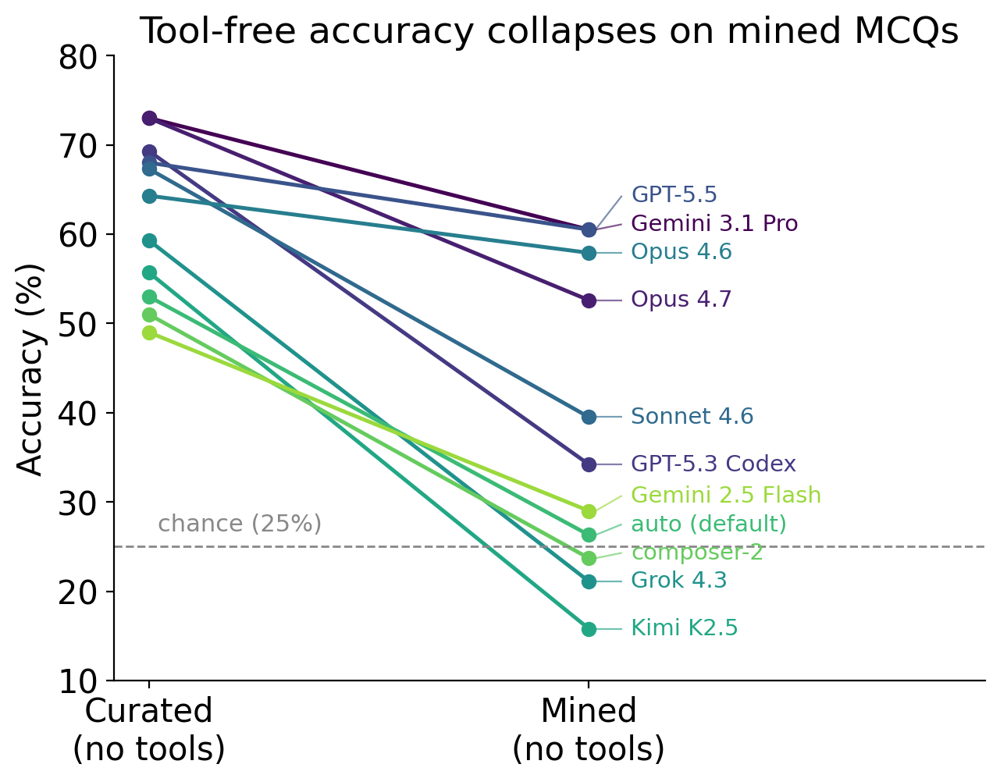

# Backtrader-Bench

[](https://arxiv.org/abs/2608.11232)
[](LICENSE)


Code and data for [*Backtrader-Bench: Benchmarking LLM Agents on Algorithmic
Trading with Self-Generated MCQs*](https://arxiv.org/abs/2608.11232)
(Ruoxi Zhao and Maziar Raissi, FinLLM Workshop @ IJCAI 2026).

Backtrader-Bench tests whether an LLM agent can *drive* a backtest, not just
write trading code: run a `backtrader` strategy under a given configuration,
read the numeric output, and report the right answer. Existing financial LLM
benchmarks test NLP-level tasks or code generation; none test this kind of
execution comprehension, where a single misused parameter yields a
plausible-but-wrong P/L.

The benchmark has two parts:

- **Curated set.** A deterministic MCQ builder covering 5 strategies and 33
  question templates across 3 difficulty tiers. Questions are generated at
  runtime from seeds, so answers cannot be memorised, and an independent
  checker re-derives every answer along the same execution path.
- **Mined set.** A generator/solver pipeline that mines hard, well-posed
  questions with no human in the loop. A generator agent writes a question
  plus executable verifier code, a no-tool solver discards items it can
  answer from memory, and a tool-enabled solver validates what remains.

## Headline results

<p align="center">
  
  
</p>

| Setting | Accuracy |
|---|---|
| Curated set, best tool-enabled agent (single pass) | 90.0% |
| Curated set, best no-tool model (10-run average) | 73.0% |
| Mined set, strongest no-tool models | about 60% |
| Mined set, weaker no-tool models | near chance (25%) |

Tool access is worth 17 points on the curated set. On the mined set, tool-free
accuracy collapses: weaker models fall to roughly chance while the strongest
plateau near 60%, bounded by the filter model. The hardest questions are
order-mechanics scenarios, exactly where real trading errors are costly.
Distractors sit 7 to 33% away from the correct value, so guessing by magnitude
does not work. Evaluation covers 11 models without tools and 4 tool-enabled
configurations; see the paper for confidence intervals and ablations.

## How mining works

Each mined question is verified by executable Python, screened by a no-tool
agent, and then checked by a tool-enabled agent:

- If the no-tool agent answers correctly, the MCQ is discarded as too easy.
- If the no-tool agent misses or cannot answer, the MCQ is sent to the
  tool-enabled runner.

All generated candidates are written to one run-level MCQ JSONL with labels
such as `verified-well-pose`, `easy-discarded`, `tool-solver-correct`,
`tool-solver-wrong`, and `verifier-fail`.

## Repository Contents

- `mine_backtrader_questions.py` -- main mining loop.
- `mcq_mining_core.py` -- verifier execution, tagged-block parsing, seed-based choice building, and agent invocation helpers.
- `db.py` -- run-scoped JSONL persistence under `db/mining_<timestamp>_rounds_<N>/`.
- `agent_backends.py` -- local wrappers for supported generator CLIs.
- `run_cursor_mcq.py` -- Cursor Agent CLI runner with tools enabled.
- `run_cursor_sdk_mcq_notool.mjs` -- Cursor SDK runner that cancels on tool use.
- `Backtrader_MCQ/` -- standalone Backtrader question builder/checker and reference datasets.
- `prompts/backtrader_network_generator.txt` -- generator prompt for seed-aware Backtrader verifier specs.
- `requirements.txt` -- Python dependencies.

Bundled benchmark files:

- `datasets/backtrader_mcq_balanced_30_all_strategies.jsonl`
- `datasets/backtrader_mcq_base_pool_all_strategies.jsonl`
- `Backtrader_MCQ/croissant.json`

## Setup

Use Python 3.11 or newer.

```bash
python3 -m venv .venv
.venv/bin/pip install -r requirements.txt
npm install @cursor/sdk
export CURSOR_API_KEY="cursor_..."
```

The generator also needs one supported non-interactive agent CLI installed and
authenticated. The backend registry supports `cursor`, `claude`, `codex`, and
`copilot`, depending on what is available on the machine.

## Mine Questions

```bash
.venv/bin/python mine_backtrader_questions.py --attempts 10
```

Useful options:

```bash
# Prompt for attempts, models, and timeouts.
.venv/bin/python mine_backtrader_questions.py --interactive

# Choose models and add a label to the dated run folder.
.venv/bin/python mine_backtrader_questions.py \
  --attempts 20 \
  --run-name manual \
  --generator-model composer-2 \
  --no-tools-model composer-2 \
  --with-tools-model composer-2

# Reproduce seed perturbations.
.venv/bin/python mine_backtrader_questions.py \
  --attempts 5 \
  --base-seed 12345 \
  --seed-step 1009
```

For each attempt, the generator emits a question stem and standalone verifier
code. The verifier reads `MCQ_SEED`, computes a Backtrader result, and prints
`QUESTION_JSON:` plus `ANSWER_VALUE_JSON:`. The miner runs the verifier with a
base seed for the true value and perturbed seeds for distractors, shuffles four
choices, records the answer letter, and writes `question.jsonl` / `question.json`
for the Cursor runners.

## Outputs

Every mining run creates new date-stamped files under category folders in `db/`,
for example:

```text
db/mcq/mining_20260515_032000_rounds_10_questions.jsonl
db/attempts/mining_20260515_032000_rounds_10_attempts.jsonl
db/summary/mining_20260515_032000_rounds_10_final_summary.json
```

The run files include:

- `db/mcq/<run>_questions.jsonl` -- all MCQ candidates for the run, with labels for verifier status, no-tools hardness, and tool-solver result.
- `db/attempts/<run>_attempts.jsonl` -- no-tools and with-tools runner attempts with usage metadata.
- `db/summary/<run>_summary.jsonl` and `db/summary/<run>_final_summary.json` -- counts, timing, models, and token totals.

Per-attempt artifacts are written under `logs/<run>/attempt_XXX/`, including
generator prompts/outputs, verifier stdout/stderr, runner reports, and
one-question JSON inputs.

## Run Cursor On Existing MCQs

Tool-enabled runner:

```bash
.venv/bin/python run_cursor_mcq.py \
  --input datasets/backtrader_mcq_balanced_30_all_strategies.jsonl \
  --model composer-2 \
  --timeout 180
```

No-tools runner:

```bash
node run_cursor_sdk_mcq_notool.mjs \
  --input datasets/backtrader_mcq_balanced_30_all_strategies.jsonl \
  --model composer-2 \
  --timeout 120
```

## Standalone Backtrader Dataset Checks

Generate and verify one Backtrader MCQ with the bundled deterministic builder:

```bash
mkdir -p Backtrader_MCQ/output
.venv/bin/python Backtrader_MCQ/backtrader_MCQ_builder.py \
  --symbol AAPL \
  --start-date 2020-01-01 \
  --end-date 2020-06-01 \
  --initial-cash 50000 \
  --commission-rate 0.001 \
  --stake 1000 \
  --strategy sma_crossover \
  --num-questions 1 \
  --difficulty easy \
  --seed 42 \
  -o Backtrader_MCQ/output/standalone_smoke.json

.venv/bin/python Backtrader_MCQ/backtrader_MCQ_checker.py \
  Backtrader_MCQ/output/standalone_smoke.json
```

Compile the maintained Python modules:

```bash
.venv/bin/python -m py_compile \
  mine_backtrader_questions.py mcq_mining_core.py run_cursor_mcq.py \
  agent_backends.py db.py \
  Backtrader_MCQ/backtrader_MCQ.py \
  Backtrader_MCQ/backtrader_MCQ_builder.py \
  Backtrader_MCQ/backtrader_MCQ_checker.py \
  Backtrader_MCQ/backtrader_MCQ_pipeline.py \
  Backtrader_MCQ/backtrader_info.py \
  Backtrader_MCQ/strategies.py
```

## Citation

```bibtex
@article{zhao2026backtraderbench,
  title   = {Backtrader-Bench: Benchmarking LLM Agents on Algorithmic Trading
             with Self-Generated MCQs},
  author  = {Zhao, Ruoxi and Raissi, Maziar},
  journal = {arXiv preprint arXiv:2608.11232},
  year    = {2026},
  url     = {https://arxiv.org/abs/2608.11232},
  note    = {FinLLM Workshop, IJCAI 2026}
}
```
